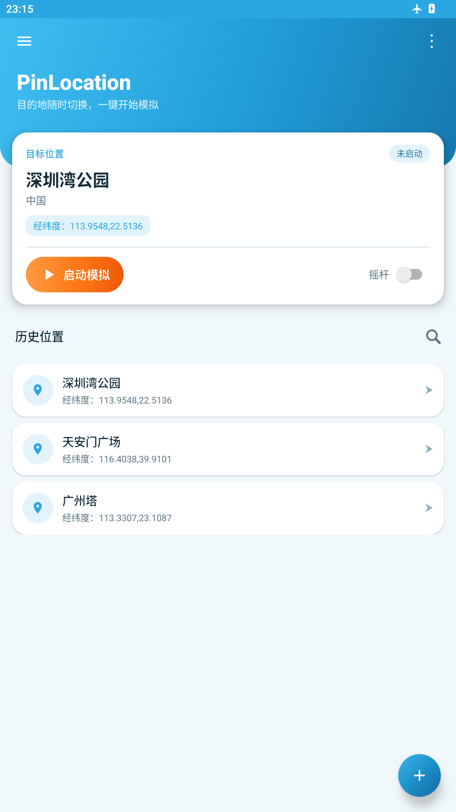
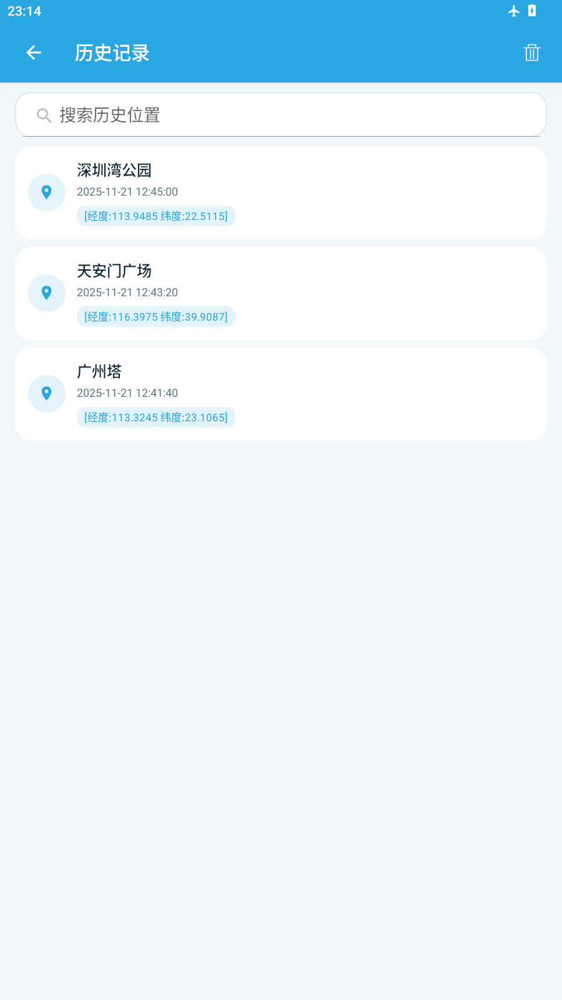
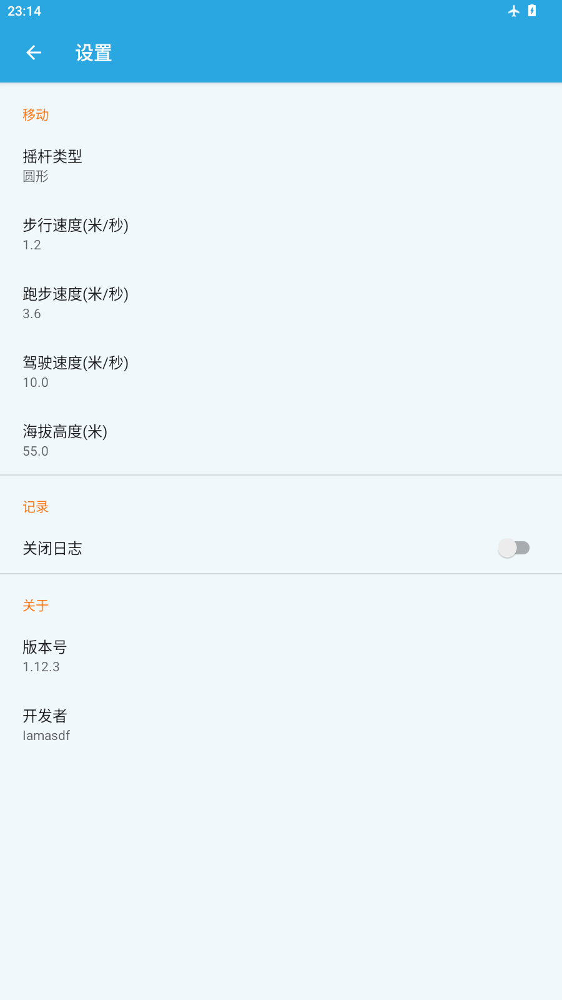

# PinLocation

PinLocation is a mock-location app for Android that works without root. It supports picking points on a map, place search, coordinate input, and a floating joystick, plus pinning, editing, and deleting saved locations. Current version: **1.12.3** (versionCode 1123).

[中文说明](./README.md)

## Screenshots

| Home | History | Settings |
| :---: | :---: | :---: |
|  |  |  |

## Features

### Home: location simulation

- Target card with name, city, and BD09 coordinates.
- History list sorted by pinned state and time, with a name filter.
- Long-press a history item to pin/unpin, edit, or delete it.
- Start/stop simulation with one button; a foreground-service notification appears while running.
- Drawer and overflow menu: history, settings, developer options, check for updates, feedback, contact.

### Map selection

- Normal and satellite layers; double-tap or buttons to zoom.
- Tap the map or a POI to drop a marker; long-press to also reverse-geocode an address.
- Place autocomplete search.
- Coordinate input in BD09 or GPS (WGS84); values are converted to BD09 for display.
- POI info window: save the point to history and return home, copy coordinates, share coordinates.
- "Back to current location" recentres the map on the device position.

### History and location editing

- History screen: search, tap to set as target, long-press to rename or delete, delete all.
- Edit screen: change name, address, altitude, longitude, and latitude; tapping the embedded map re-selects the point.
- Each saved point stores both WGS84 and BD09 coordinates; home shows BD09 and the simulation service receives WGS84.

### Floating joystick

- Requires the overlay permission; toggle it from home or from the notification.
- Two styles: round joystick or button pad (chosen in settings).
- Map panel: search, tap the map to pick a point, and "go" to move the simulated position there.
- History panel: pick a previously saved location.
- Three speed presets: walking, running, cycling.

### Settings

- Joystick style; walking (1.2 m/s), running (3.6 m/s), and driving (10.0 m/s) speeds; altitude (55.0 m); disable logging; version and author.

Random offset, history retention, location accuracy, and update interval are **not** exposed in this version, even though a few unused strings remain in the resources.

### How it runs

- Uses Android's mock-location API; no root required.
- A foreground service keeps the simulation alive, and its notification can show or hide the joystick.
- Logs are written to `Android/data/<package>/files/Logs/PinLocation.log` and kept for three days. "Feedback" shares that file.

### Not included

Route editing/playback, GPX import/export, favourites and groups, per-instance installs or membership, night map style, accuracy/update-interval settings, and switching to Amap/Tencent maps. Related resources (`array_map_type`, etc.) are leftovers and are not wired to any UI.

## Requirements

| Item | Value |
| --- | --- |
| Minimum OS | Android 8.1 (API 27) |
| compileSdk / targetSdk | 32 / 32 |
| ABI | `arm64-v8a` only |
| JDK | 17 |
| Gradle / AGP | 8.13 / 8.12.1 |
| NDK / Build Tools | 26.2.11394342 / 36.0.0 |

## Install and first run

1. Install the APK on a 64-bit ARM device.
2. Grant location permission; on Android 10+ choose "Allow all the time" if the simulation must keep running in the background.
3. Enable Developer options → "Select mock location app" → choose PinLocation.
4. On the home screen, tap ＋ to pick a point on the map, or select a history entry, then tap "Start simulation".
5. To use the floating joystick, turn on the joystick switch and grant the overlay permission.

There is no welcome or consent screen; the app opens directly on the home screen.
