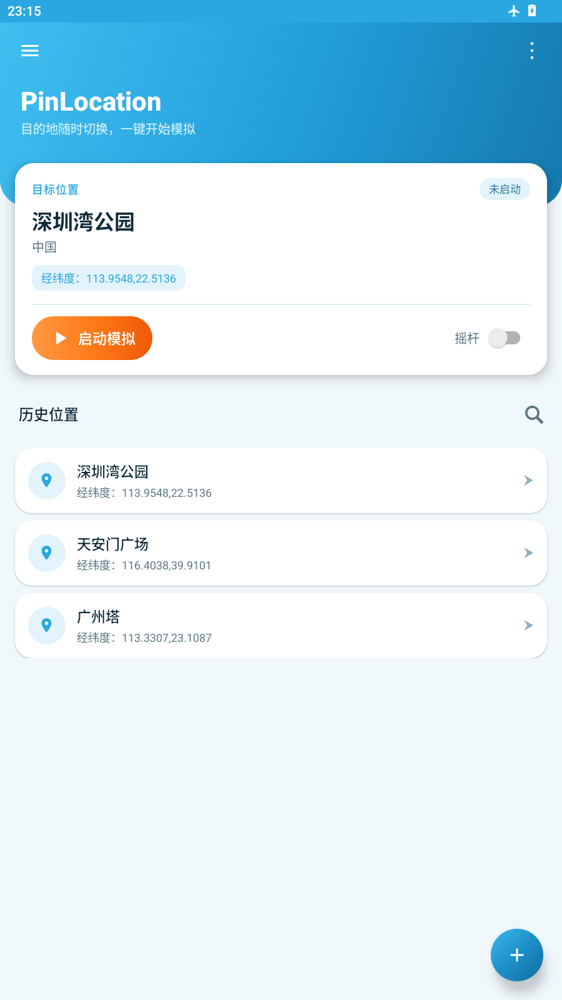
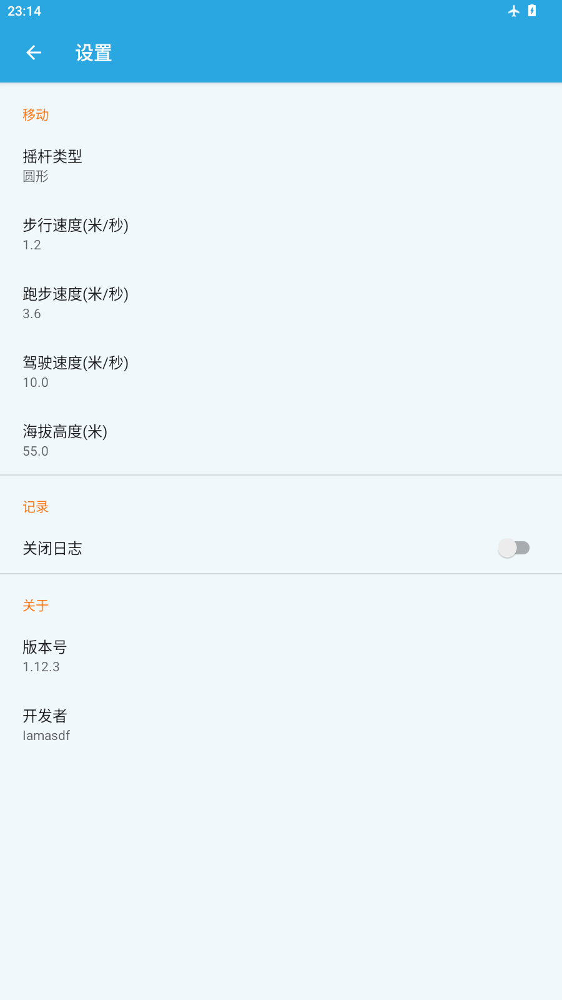

# PinLocation

PinLocation 是一款免 Root 的 Android 位置模拟应用，支持地图选点、地点搜索、坐标输入和悬浮摇杆，并提供历史位置的置顶、编辑与删除。当前版本 **1.12.3**（versionCode 1123）。

[English](./README.en.md)

## 界面截图

| 首页 | 历史记录 | 设置 |
| :---: | :---: | :---: |
|  |  |  |

## 1. 功能

### 1.1 首页：位置模拟

- 目标位置卡片：显示名称、城市和经纬度（BD09）。
- 历史位置列表：按置顶、时间排序，右上角搜索按钮可按名称过滤。
- 长按历史项：置顶 / 取消置顶、编辑、删除。
- 「启动模拟 / 停止模拟」一键切换；运行时显示前台服务通知。
- 左侧抽屉与右上角菜单：历史记录、设置、开发人员选项、检测更新、问题反馈、联系作者。

### 1.2 地图选点

支持：

- 普通图与卫星图切换，双击或按钮缩放。
- 单击地图或 POI 选点并放置标记；长按地图选点并逆地理编码显示地址。
- 地点联想搜索，选中搜索结果直接跳到该位置。
- 坐标输入：支持 BD09 与 GPS（WGS84）两种坐标系，输入后自动换算到 BD09 显示。
- POI 信息窗：保存该位置（写入历史并返回首页）、复制坐标、分享坐标。
- 「返回当前位置」将地图移回设备定位点。

### 1.3 历史记录与位置编辑

- 历史记录页：关键字搜索、点击记录设为目标位置、长按改名或删除、一键删除全部。
- 位置编辑页：修改名称、详细地址、海拔和经纬度，点击页内小地图可重新选点。
- 选中位置时写入两条坐标：WGS84 与 BD09；首页展示 BD09，启动模拟时转换为 WGS84 交给系统。

### 1.4 悬浮摇杆

- 需要悬浮窗权限，在首页开关或通知栏中显示 / 隐藏。
- 两种样式：圆形摇杆、按键摇杆（设置中切换）。
- 地图面板：搜索地点、点击地图选点、「前往」把模拟位置切到该点。
- 历史面板：从已保存的历史位置中选择。
- 三档速度：步行、跑步、自行车，速度值见设置页。

### 1.5 设置

- 摇杆类型（圆形 / 按键）。
- 步行速度（默认 1.2 m/s）、跑步速度（默认 3.6 m/s）、驾驶速度（默认 10.0 m/s）。
- 海拔高度（默认 55.0 m）。
- 关闭日志、版本号、开发者信息。

> 当前版本的设置页不包含随机偏移、历史记录有效期、定位精度或更新间隔等选项；`strings.xml` 中保留了个别未使用的文案。

### 1.6 运行机制

- 通过 Android 的模拟位置接口工作，无需 Root，也不需要修改系统。
- 使用前台服务维持模拟，通知栏提供摇杆显示 / 隐藏操作。
- 日志写入应用私有目录 `Android/data/<应用包名>/files/Logs/PinLocation.log`，保留最近 3 天；「问题反馈」会把该日志文件作为附件分享出去。

### 1.7 本工程未包含的能力

线路编辑与移动、GPX 导入导出、收藏与分组、独立安装实例 / 会员、夜间地图、定位精度与更新间隔设置、高德 / 腾讯地图切换。`array_map_type` 等资源为历史残留，未接入界面。

## 2. 环境与依赖

| 项目 | 值 |
| --- | --- |
| 最低系统 | Android 8.1（API 27） |
| 编译 / 目标版本 | compileSdk 32、targetSdk 32 |
| ABI | 仅 `arm64-v8a` |
| JDK | 17 |
| Gradle / AGP | Gradle 8.13、AGP 8.12.1 |
| NDK / Build Tools | 26.2.11394342、36.0.0 |

主要依赖：AndroidX AppCompat、ConstraintLayout、Preference、Material、OkHttp、XLog、Markwon。

## 3. 安装与首次使用

1. 安装 APK（仅支持 64 位 ARM 设备）。
2. 授予定位权限；Android 10 及以上如需后台持续模拟，请选择「始终允许」。
3. 打开系统「开发者选项」→「选择模拟位置信息应用」→ 选择 PinLocation。
4. 在首页点击 ＋ 进入地图选点，或从历史位置中选择目标，然后点「启动模拟」。
5. 需要使用悬浮摇杆时，打开首页的摇杆开关并按提示授予悬浮窗权限。

应用不设欢迎页或协议页，启动即进入首页。
